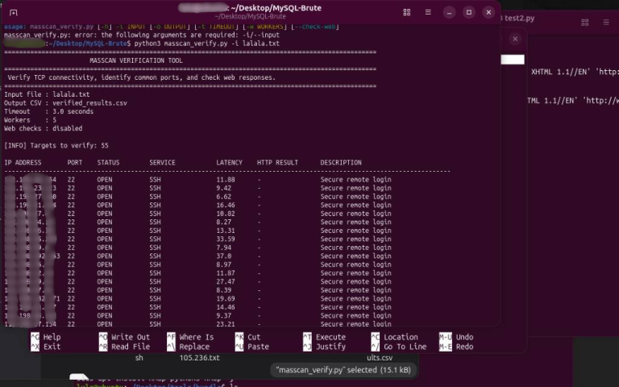
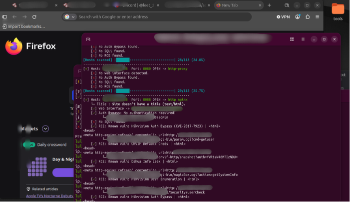

🐻 BEAR Scanner v2.1
NMap + Vulns
text
     (｡◕‿◕｡) その BEAR その

     ▄▄▄▄▄▄▄▄▄▄▄▄▄▄▄▄▄▄▄▄▄▄▄▄▄▄▄▄▄▄
     █  ____  ____  ____  ____  █
     █ |\   |__|  |  \ |  |   █
     █ |__/  |  |  | _/  |__|   █
     ▀▀▀▀▀▀▀▀▀▀▀▀▀▀▀▀▀▀▀▀▀▀▀▀▀▀▀▀▀

      (  (  (  BEAR Scanner  )  )  )
         \_  \_  NMap + Vulns _/  _/
           \_      BEAR      _/
             \_  v2.1-BEAR  _/

📸 Screenshots
🐻 BEAR Scanner Preview

💻 BEAR Scanner Running

📖 About

BEAR Scanner v2.1 is a terminal-based project featuring a custom BEAR-themed interface.

Designed for a simple and recognizable command-line experience.

✨ Features
🐻 Custom BEAR ASCII banner
💻 Terminal-based interface
🐧 Linux compatibility
🐍 Python 3 support
📦 Standalone executable option
🖥️ Compatibility
Ubuntu
Kali Linux
Debian
Other Linux distributions
⚠️ Disclaimer

This project is intended for educational purposes and authorized security testing only.

Only test systems and networks that you own or have explicit permission to assess.

The author is not responsible for unauthorized use.

📩 Contact
NEED THE TOOL?

DM ME ON DISCORD

Discord: beeeeeaaaar

 <b>🐻 BEAR Scanner v2.1</b>  <i>Built with BEAR energy.</i> 

